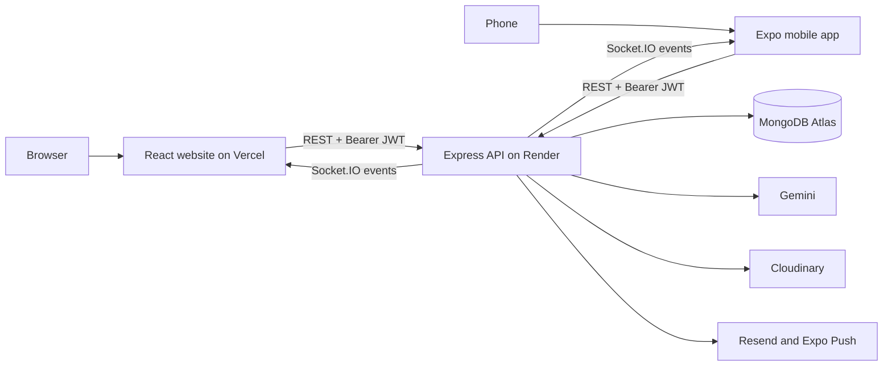
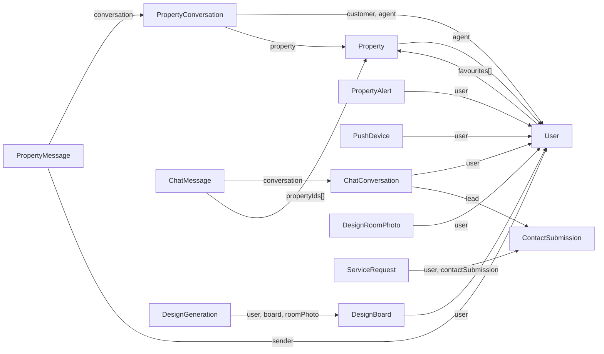
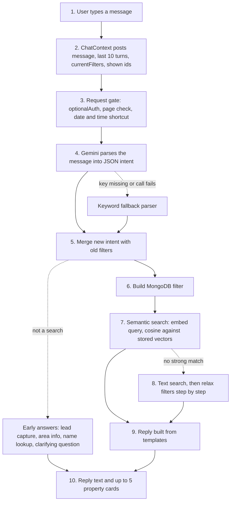

# Varlikent Architecture Review

Reviewed on 2026-10-08. Analysis and documentation only: no application code, schema or deployment was changed.

## 1. What was reviewed

Varlikent is two Git repositories, not one.

| Repository | Folder on disk | Revision reviewed | Contains |
|---|---|---|---|
| `Arqam709/varli-kent` | `Desktop/varlikent` | `85c77be` (same commit as `main`) | `backend/` (Express API) and `frontend/` (React website) |
| `Arqam709/varlikent-app` | `Desktop/varlikent-app` | `71046f6` (`main`) | Expo / React Native mobile app |

When the review started, the web/backend repo had uncommitted edits in the page-content files (`backend/routes/pageContent.js`, `backend/utils/translationState.js` and their tests). While the review was running, those edits were committed by someone else as `12121fd` ("feat: track cms translation state") on the branch `feat/cms-translation-state`. I did not make that commit and I did not cite any of the seven files it touches. Every line number below refers to commit `85c77be`, which is still what `main` points to.

Other `varlikent*`, `zillwork*` and `realstate` folders on the Desktop are old zips and snapshots. They were ignored.

Paths below are written relative to each repo: `backend/...` and `frontend/...` are in `varlikent`; `src/...` is in `varlikent-app`.

## 2. Status of the diagrams

All seven diagrams are rendered by Archify 3.0.1 and pass every gate. Updated 2026-10-08, after the first version of this section reported six of them as blocked.

| Diagram | Type | Archify gates | Looked at by eye |
|---|---|---|---|
| `system-overview.html` | architecture | validate, deliver, check 9/9, browser-check: pass | Yes. No crossings. |
| `frontend-architecture.html` | architecture | pass | Yes. No crossings. |
| `backend-architecture.html` | architecture | pass | Yes. No crossings. |
| `database-architecture.html` | architecture | pass | Yes. No crossings; one arrow (ChatConversation to User) takes a long way round. |
| `authentication-flow.html` | sequence | pass | Yes. |
| `chatbot-architecture.html` | workflow | pass | Yes. No crossings; the POST arrow loops round the left edge. |
| `mobile-architecture.html` | architecture | pass | Yes. No crossings. |

What the gates mean:

- **validate**: the JSON matches Archify's schema, every cited file and line range exists at the pinned commit, and the layout meets the "showcase" rules (no overlapping boxes, no line through a box, readable text size).
- **deliver** and **check**: the HTML on disk is byte-for-byte the file Archify produced from that spec (9 artifact checks, provenance "current").
- **browser-check**: opened in headless Chrome at four desktop sizes, light and dark, with no horizontal overflow.
- **Looked at by eye**: I read Archify's own screenshots of each diagram. This is my judgement, not an automated result.

### How the earlier blocker was resolved

The cause was the system Node.js version, not Archify. On this Windows build, Node 22.14.0 (libuv 1.49.2) reports device id `0` for path-based `stat` calls and the true id for handle-based ones. Archify's file-safety check compares the two and stops. Node 22.23.3 (libuv 1.51.0) and Node 24.21.0 report the same id both ways, so unmodified Archify works.

The diagrams were rendered with a portable copy of Node 22.23.3 downloaded from nodejs.org (checksum verified) into a temporary folder. The system Node installation was not changed. No preload script and no bypass was used.

Archify 3.0.1 is the latest release. Its tracker has no report of this error; the nearest is open issue 474 about Windows path identity, which names Windows Node 22 and 24 as the tested targets.

### What changed in the specs to pass and to read well

- **System overview**: re-laid out so lines no longer cross (10 crossings before, 0 now). The guards box now sits beside the API bar, and MongoDB is a normal box. The arrow from the guards to MongoDB was removed and its fact moved to the "Trust boundary" card. The first render, made under the earlier workaround, is kept in `archify/previous/`.
- **Frontend**: narrowed to five columns so text stays readable. "Signed-in pages" moved into a card, and the socket.io client merged into the RealtimeContext box.
- **Authentication**: narrowed and shortened to fit a desktop screen. The Socket.IO handshake moved from a fourth section into the "Trust boundaries" card.
- **Chatbot**: five lanes became four. All nodes and arrows were kept.
- **Backend, database, mobile**: unchanged from the first specs.

## 3. Which claimed systems actually exist

| Claimed in the brief | Found | Where |
|---|---|---|
| React + Vite frontend with Tailwind | Yes | `frontend/package.json`, `frontend/vite.config.js` |
| Node + Express backend | Yes. Express 5, ES modules | `backend/server.js` |
| MongoDB with Mongoose | Yes. 26 models | `backend/models/`, `backend/config/db.js` |
| JWT auth | Yes. 7-day token, id only | `backend/routes/auth.js:19-20` |
| Google OAuth | Yes, web and mobile | `backend/services/googleAuth.js` |
| Microsoft OAuth | Yes, web only | `backend/routes/auth.js:329-412` |
| Admin dashboard | Yes. 16 `/admin/*` routes | `frontend/src/App.jsx:85-100` |
| Agent portal | Yes. Web only | `frontend/src/App.jsx:107-120` |
| Listings, filtering, favourites, inquiries | Yes | `backend/routes/properties.js`, `users.js`, `contact.js` |
| AI chatbot with Gemini and embeddings | Yes. Web only | `backend/routes/chat.js` |
| Real-time messaging | Yes. Socket.IO, server to client only | `backend/realtime/socket.js` |
| Notifications | Partly. Expo push exists; there is no Notification collection | `backend/routes/notifications.js:48-81` |
| React Native app | Yes, in its own repo | `varlikent-app/src/` |
| Cloudinary | Yes | `backend/config/cloudinary.js` |
| Vercel frontend | Yes | `frontend/vercel.json` |
| Render backend | Inferred. No `render.yaml` in the repo | `src/constants/config.ts:13`, comments in `backend/server.js:143-146` |

Found but not in the brief: Resend (email), Expo Push, OpenStreetMap Overpass and Nominatim (chatbot place answers), MyMemory (translation), a Cloudflare image provider, "Design My Space" with an AI image worker, service requests, property alerts, and an owner-removal approval flow.

Present in the schema but unused: Apple sign-in. `User.provider` allows `'apple'` and `.env.example` lists `APPLE_CLIENT_ID`, but there is no Apple route. `User.microsoftId` and `User.appleId` are never read or written.

## 4. How the whole application works

### 4.1 The big picture

There are two clients and one server.

- The **website** is a React single-page app. Vercel serves the static files. In the browser it calls the backend with axios.
- The **mobile app** is an Expo app. It calls the same backend with `fetch`.
- The **backend** is one Node process. It serves REST under `/api`, runs Socket.IO on the same port, and also runs the AI image worker and two cleanup timers.
- **MongoDB Atlas** holds all data. Only the backend talks to it.

Both clients prove who they are the same way: they send `Authorization: Bearer <JWT>` on each request.

*Mermaid fallback, drawn by hand from the same facts. It is not Archify output.*

### 4.2 Example: a user opens a property page (website)

1. The browser loads `/properties/abc123`. `vercel.json` rewrites every path to `/`, so Vercel returns the same `index.html`.
2. `frontend/src/main.jsx:38-60` builds the provider tree: MSAL, Google, Language, Auth, Realtime, Favourites, Chat.
3. `frontend/src/App.jsx:68` matches the route and renders `PropertyDetailsPage` inside `PublicLayout`. No guard is involved, because the page is public.
4. The page calls `api.get('/properties/abc123')`. `frontend/src/lib/api.js:9-15` adds the token if one is stored.
5. On the server the request passes `cors`, `express.json` and `activityLogger` (`backend/server.js:51-59`), then reaches `backend/routes/properties.js:989`.
6. The handler runs `Property.findById(id)`, hides private fields, and populates the agent's public profile.
7. It answers `{ success: true, property }`. React renders the page.

Nothing is cached on the client. Opening the page again repeats the request.

### 4.3 Example: a customer messages an agent (mobile app to website)

1. In the app, the customer taps "Message" on a listing. `src/features/property-messaging/property-messaging-api.ts:47` calls `POST /api/property-conversations`.
2. The customer sends text. `sendPropertyMessage` (line 93) calls `POST /api/property-conversations/:id/messages`.
3. `router.use(protect)` checks the JWT (`backend/routes/propertyConversations.js:53`).
4. The handler at line 377 checks that this user belongs to the conversation, then finds who the listing's agent is **right now** from `Property.agent`.
5. It saves a `PropertyMessage` (line 411) and updates the conversation's last message and unread counter (line 429).
6. It emits `property-message:new` to the rooms `user:<customerId>` and `user:<agentId>` (line 476).
7. It asks Expo to send a push notification, without waiting for the result (line 501).
8. It answers `201` to the app.
9. On the website, the agent's open socket receives the event and the inbox updates. If the socket was down, the page reloads messages over REST when it reconnects.

The important design rule: **REST is the only way to write.** The socket has no client-to-server events at all (`backend/realtime/socket.js:10-17`). It only tells clients that something changed.

### 4.4 Example: a visitor asks the chatbot for an apartment

See section 7.

## 5. How the frontend talks to the backend

- One axios instance exists: `frontend/src/lib/api.js`. A request interceptor attaches the token from `localStorage`.
- Contexts use it for shared state: `AuthContext` (login, `/auth/me`), `ChatContext`, `FavouritesContext`, `ThemeContext`, `SiteSettingsContext`.
- Pages also call it directly. 43 files contain `api.get/post/put/delete` calls. Only messaging has a dedicated API module (`frontend/src/lib/propertyMessagingApi.js`).
- Route protection in the browser is `frontend/src/components/ProtectedRoute.jsx`. It reads `isAdmin`, `isOwner`, `isAgent` from `AuthContext`. Its own comment says it is UX, not security.
- Language is stored under `vk_lang`, sets `<html lang>` and `dir="rtl"` for Arabic and Urdu. Theme is stored under `vk_theme`, sets `data-theme`, and is saved to the account with `PUT /users/me/theme`.

How a user navigates: every URL goes through the flat route table in `App.jsx`. Public pages render in `PublicLayout` (navbar, page, footer, chatbot). Guarded pages go through `ProtectedRoute`, which sends a logged-out user to `/login` and a user with the wrong role to `/`.

## 6. How the backend talks to MongoDB

- `backend/config/db.js` opens one Mongoose connection at startup. The server only starts listening after it connects (`backend/server.js:158-171`).
- There is no controllers folder. Each file in `backend/routes/` holds its own handler functions.
- Handlers either call a model directly (`Property.find(...)`) or call a module in `backend/services/` that does.
- Authorization is done by three small middleware functions placed on each route:
  - `protect` verifies the JWT and loads the user from MongoDB on every request (`backend/middleware/auth.js:4-31`).
  - `requireRole('owner', 'admin')` checks the role.
  - `requirePermission('add_listing')` checks one named permission. The owner passes every permission check.
- Errors go to one handler: `backend/server.js:115-118`.

Data model in short:

*Mermaid fallback. Every arrow is a real `ref:` in a Mongoose schema; the full list with line numbers is in `archify/database-architecture.json`.*

Three things that surprise people:

- **Favourites are not a collection.** They are an array of property ids on the user: `backend/models/User.js:50`.
- **Notifications are not a collection.** The feed is "properties created after `User.notificationsLastSeenAt`": `backend/routes/notifications.js:54`.
- **MongoDB does not enforce references.** Deleting a property leaves its id inside users' favourites and chat messages.

Eleven collections have no references at all: Review, Project, Partner, TeamMember, ShowroomImage, AboutContent, PageContent, StudioPalette, SiteSettings, LeadRouting, ContactInterest.

## 7. How the chatbot is integrated

The chatbot is a widget (`frontend/src/components/AIChatbot.jsx`) mounted by `PublicLayout`, so it appears on every public web page. The mobile app has no chatbot: it never calls `/api/chat`.

*Mermaid fallback of the pipeline in `backend/routes/chat.js`.*

| Stage | File responsible |
|---|---|
| 1. User sends a message | `frontend/src/components/AIChatbot.jsx:291-297` |
| 2. API request | `frontend/src/contexts/ChatContext.jsx:405-464` |
| 3. Gate | `backend/routes/chat.js:60-127`, `168-196` |
| 4. Gemini parse | `backend/utils/geminiPropertyParser.js:1187-1233` (model `gemini-3.1-flash-lite`) |
| 4b. Parser fallback | `backend/services/chatMessageParsing.js:806` |
| 5. Merge context and filters | `backend/services/chatConversationMemory.js:468` |
| Early answers | `chatLeadFlow.js`, `areaInfoAnswer.js`, `propertyNameResolver.js`, `chatPolicyEngine.js` |
| 6. Mongo filter | `backend/services/chatFilters.js:183` |
| 7. Semantic search | `backend/services/propertySemanticSearch.js:104-162`, `backend/utils/embeddings.js` (model `gemini-embedding-001`) |
| 8. Fallback search | `backend/services/chatPropertySearch.js:55-115` and `247-297` |
| 9. Reply | `backend/services/chatReplyBuilder.js:280`, `chatReplyRenderer.js` |
| 10. Response and saving | `backend/routes/chat.js:798-827`, `backend/services/chatPersistence.js:94` |

Things worth understanding:

- **Gemini does two jobs only.** It turns a sentence into a JSON intent, and it turns text into a vector of numbers. It does not write the reply and it does not choose properties. Replies are templates. This is a good design: the model cannot invent a listing.
- **The browser holds the conversation memory.** Each request carries `currentFilters`, the last 10 turns and the ids already shown. The server is stateless per request.
- **Signed-in users also get history saved** in `ChatConversation` and `ChatMessage`. Guests get nothing saved.
- **Listing vectors are made when an admin saves a property** (`backend/routes/properties.js:1075`), not during chat.

Existing versus unused:

| | Status |
|---|---|
| Gemini intent parsing, keyword fallback, semantic search, `$text` search, structured fallback | Existing and on the live path |
| OpenStreetMap proximity and area answers | Existing and on the live path |
| Admin listing assistant (`/api/admin/property-assistant`) | Existing; a separate feature that shares the Gemini key |
| Fallback step 4 in `searchWithFallback` | Runs, but builds the same query as step 3 (`chatPropertySearch.js:86-90` and `103-107`) |
| Chatbot in the mobile app | Does not exist |

## 8. How web and mobile share the backend

Shared: the same `/api` routes, the same JWT, the same Socket.IO events, the same response shapes. The backend trusts the mobile app's Google tokens because the app asks Google for a token minted for the **website's** client id (`src/constants/config.ts:66-90`).

Differences:

| | Website | Mobile app |
|---|---|---|
| HTTP client | axios with interceptor | `fetch` wrapper; token passed by hand |
| Token storage | `localStorage` | `expo-secure-store` |
| Sign-in | password, Google, Microsoft | password, Google |
| Socket | agents only | every signed-in user |
| Route protection | `ProtectedRoute` component | each screen checks `useAuth().status` |
| Chatbot, admin, agent portal | yes | no |
| Design My Space, service requests, alerts, push | no | yes |

Because the two clients live in separate repos with no shared package, the same logic is written twice. Example: `frontend/src/lib/recoverThreadMessages.js` and `src/utils/recover-thread-messages.ts`. The mobile repo has "parity" tests (`tests/service-parity.test.mjs`, `tests/studio-palette-parity.test.mjs`) whose job is to catch the two copies drifting apart.

## 9. Findings

Each finding lists evidence from the source. Priority is my judgement; "risk of changing" is how likely a fix is to break something.

### F1. Microsoft login can match the wrong account — Critical (pending one check)

- **Problem:** The backend identifies a Microsoft user by `preferred_username`, falling back to `email`, then looks up a Varlikent user by that address and signs them in.
- **Files:** `backend/routes/auth.js:349-362`, `35-73`; `frontend/src/lib/msal.js:12`.
- **Evidence:** `const email = (microsoftUser.preferred_username || microsoftUser.email || '').toLowerCase()` then `User.findOne({ email })`. The authority is `/common` (any Microsoft tenant). The issuer check only confirms the token's issuer matches the token's own `tid`. Tokens are accepted up to four hours after expiry (`clockTolerance: 60 * 60 * 4`).
- **Why it matters:** `preferred_username` is not a verified email. The administrator of any Microsoft tenant can create a user whose username equals an existing Varlikent account's email, sign in, and receive that account's JWT. Protected owners are excluded (`auth.js:371-377`), which shows the risk was noticed, but admins, agents and customers are not excluded.
- **What I could not confirm:** whether the Azure app registration accepts multi-tenant accounts. That setting is not in the repo. If it is single-tenant, the practical risk is much lower. This is the one check to make first.
- **Recommendation:** Identify Microsoft users by `tid` + `oid` stored in `User.microsoftId` (the field exists and is unused). Never auto-link to an existing account by email unless the token carries a verified-email claim. Reduce clock tolerance to a few minutes.
- **Risk of changing:** Medium. Existing Microsoft users are linked by email and need a one-time migration path.

### F2. No rate limiting anywhere — High

- **Files:** `backend/package.json`, `backend/server.js:51-59`.
- **Evidence:** No rate-limit, helmet or sanitising package in the dependencies; a search of the backend for those names finds only comments about third-party limits.
- **Why it matters:** Unlimited password guessing on `POST /api/auth/login` (`auth.js:108`). Unlimited reset emails (`auth.js:163`). `POST /api/chat` is public and each call can spend Gemini quota (`chat.js:60`). `POST /api/contact` is public and sends an email per call (`contact.js:16`, `65`).
- **Recommendation:** Add per-route limits: strict for auth, moderate for chat and contact.
- **Risk of changing:** Low.

### F3. `/api/translate` is an open proxy with an unbounded cache — High

- **Files:** `backend/routes/translate.js:5`, `10-36`.
- **Evidence:** No `protect`. `const cache = new Map()` is never trimmed. The `texts` array has no length limit and each entry triggers an outbound request.
- **Why it matters:** Anyone can make the server send many requests to MyMemory, and can fill the process memory until Render restarts it.
- **Recommendation:** Cap array length and text size, bound the cache, rate-limit the route.
- **Risk of changing:** Low.

### F4. REST CORS does not use the shared allowlist the comments describe — Medium

- **Files:** `backend/server.js:51-56`, `129-142`; `backend/config/origins.js:65-81`.
- **Evidence:** Express uses `origin: process.env.FRONTEND_URL || '*'` with `credentials: true`. Socket.IO uses `ALLOWED_ORIGINS`. The comment at lines 129-132 says "Both now read the same allowlist".
- **Why it matters:** REST and sockets can disagree about which origins are allowed, which is the exact failure `origins.js` was written to prevent. If `FRONTEND_URL` is unset the REST API falls back to a wildcard. Impact is limited because auth uses a header, not cookies.
- **Recommendation:** Pass `isAllowedOrigin` to `cors()`.
- **Risk of changing:** Low. Test a Vercel preview deployment.

### F5. Very large files with mixed responsibilities — Medium

- **Evidence (lines):** `backend/routes/properties.js` 1293; `backend/utils/geminiPropertyParser.js` 1234; `backend/routes/chat.js` 833, one handler from line 60 to 831; `frontend/src/pages/AdminProperties.jsx` 1784; `frontend/src/pages/HomePage.jsx` 1004; `frontend/src/components/AIChatbot.jsx` 924; `frontend/src/locales/translations.js` 10,545; mobile `src/app/messages/[id].tsx` 935.
- **Duplicated logic:** `recordChatExchange` is called at nine places in `chat.js` (lines 132, 173, 258, 321, 364, 447, 531, 583, 799), each followed by the same response shape. `uploadToCloudinary` is defined twice (`routes/upload.js:119`, `routes/users.js:19`). `/api/properties/sale` and `/rent` (`properties.js:913-938`) repeat what the `listingType` filter already does.
- **Why it matters:** A change to how replies are saved must be made nine times. Large files are hard to test and to review.
- **Recommendation:** In `chat.js`, extract one `respond()` helper first: it is the smallest change with the biggest effect. Move parsing and validation helpers out of `properties.js`.
- **Risk of changing:** Medium. The backend has 86 test files, which lowers it.

### F6. Authorization is applied inconsistently — Medium

- **Evidence:**
  - `backend/routes/contact.js:91-95`: `PATCH /:id/status` has `protect` and `requirePermission` but no `requireRole`, unlike the GET (75-79) and DELETE (114-118) beside it.
  - `backend/routes/upload.js:133-137`, `198`: role check only. `POST /api/properties` needs `add_listing` (`properties.js:1015-1019`), but uploading or deleting media needs no permission.
  - `frontend/src/App.jsx:89` allows only the owner into `/admin/users`, while `backend/routes/users.js:27-31` also allows anyone with `user_management`.
  - `backend/routes/users.js:27-61` defines three custom guard functions that repeat `requirePermission` from `middleware/checkPermission.js:10-20`.
- **Why it matters:** The real rule for each area is hard to state, and the UI and API disagree.
- **Recommendation:** Write one table of route to role and permission, then make every route use `requireRole` plus `requirePermission`.
- **Risk of changing:** Low.

### F7. Tokens cannot be revoked and the web stores them in localStorage — Medium

- **Files:** `backend/routes/auth.js:19-20`, `156-158`; `frontend/src/contexts/AuthContext.jsx:46-47`; `frontend/src/lib/api.js:9-15`.
- **Evidence:** Tokens last 7 days. Logout only answers "Logged out". The User schema has no token version or password-changed timestamp. The axios client has no response interceptor.
- **Why it matters:** A stolen token works for up to a week, even after a password change. Any script injection on the site can read it. When a token expires, each page handles the 401 differently.
- **Recommendation:** Add a `tokenVersion` on User, checked in `userFromToken`; bump it on password change. Add one response interceptor that logs out on 401.
- **Risk of changing:** Medium. Touches every authenticated request.

### F8. Listing endpoints return everything, with almost no indexes — Medium

- **Files:** `backend/routes/properties.js:886-891`; `backend/models/Property.js:178`, `243-260`.
- **Evidence:** `GET /api/properties` has no `limit` or `skip`. The only indexes on Property are the text index and `agent`.
- **Why it matters:** Fine for a few hundred listings. Response size and query time grow with every listing added.
- **Recommendation:** Add optional `page` and `limit` (a helper already exists in `backend/utils/pagination.js`), then an index for the common filter.
- **Risk of changing:** Medium. Both clients must adopt paging; keep the old behaviour as the default at first.

### F9. Semantic search compares vectors in Node memory — Medium (low today)

- **Files:** `backend/services/propertySemanticSearch.js:119-139`.
- **Evidence:** Every chat turn with a soft wish embeds the query through Gemini, loads every matching property with its vector, and computes cosine similarity in a JavaScript loop.
- **Why it matters:** Cost and latency grow linearly with the number of listings.
- **Recommendation:** Keep it for now. Move to Atlas Vector Search when listings reach the low thousands.
- **Risk of changing:** Medium.

### F10. Uploads are buffered in RAM — Medium

- **Files:** `backend/routes/upload.js:25`, `68-70`.
- **Evidence:** `multer.memoryStorage()` with a 100 MB limit for video.
- **Why it matters:** Two concurrent video uploads hold about 200 MB in a small Render instance.
- **Recommendation:** Upload directly from the browser to Cloudinary with a signed request.
- **Risk of changing:** Medium.

### F11. Error responses are inconsistent — Medium

- **Files:** `backend/server.js:115-118`; `backend/routes/auth.js:304-324`, `404-411`; `backend/routes/properties.js:989-991`.
- **Evidence:** The global handler returns `err.message` for 500s. Google and Microsoft handlers build their own responses and never call `next(err)`. `express-validator` is used in `auth.js` and `contact.js` only. `GET /properties/:id` passes the id to `findById` without checking its format.
- **Why it matters:** Internal error text can reach clients, and a malformed id becomes a 500 instead of a 404.
- **Recommendation:** One error class with a status; map cast errors to 404; hide messages for 500.
- **Risk of changing:** Low.

### F12. One process does everything, and sockets cannot scale out — Medium (future)

- **Files:** `backend/server.js:136-183`; `backend/services/designGenerations/worker.js:17-22`.
- **Evidence:** REST, Socket.IO, the image worker and two sweepers run in one process. Socket.IO has no adapter configured. The worker is multi-instance safe through MongoDB leases; the sockets are not.
- **Why it matters:** With two instances, a message saved on instance A would not reach a socket connected to instance B.
- **Recommendation:** Nothing now. Add a Socket.IO adapter before running a second instance.
- **Risk of changing:** Medium.

### F13. Duplicate code between website and mobile app — Low to Medium

- **Evidence:** `frontend/src/lib/{recoverThreadMessages,appendUniqueMessage,applyMessageEventToConversations}.js` and `src/utils/{recover-thread-messages,append-unique-message,apply-message-event}.ts`; `socketOrigin` in `frontend/src/lib/socket.js:36` and `src/services/socket-client.ts:41-43`.
- **Recommendation:** Extract a small shared package later; the parity tests are a reasonable stopgap.
- **Risk of changing:** Medium.

### F14. Dead code and config drift — Low

- **Evidence:** 19 files in `frontend/src` are imported by nothing, including `contexts/PropertyContext.jsx`, `pages/AdminLogin.jsx`, `components/SearchBar.jsx` and five `components/three/*` viewers. `contexts/AdminAuthContext.jsx` is imported only by two of those dead files. `.env.example` documents `MS_CLIENT_ID` but the code reads `MICROSOFT_CLIENT_ID` (`auth.js:56`, `340`). The frontend package is still named `realstate`.
- **Recommendation:** Delete after one confirming search each; fix the variable name in `.env.example`.
- **Risk of changing:** Low.

### F15. User messages are written to logs — Low

- **Files:** `backend/routes/chat.js:559-562`, `662`; `backend/services/propertySemanticSearch.js:116-117`.
- **Why it matters:** Chat text can contain names, phone numbers and emails, and Render keeps logs.
- **Recommendation:** Log ids and decisions, not message text.
- **Risk of changing:** Low.

### Checked and found fine

- **Circular dependencies:** none in the files I traced. I did not run a full cycle detector, because that would mean installing a tool.
- **Google sign-in:** audience is checked before any account lookup, `email_verified` is required, and a unique index stops one Google account owning two users.
- **Socket security:** no client events, rooms derived only from a verified JWT.
- **Per-user message deletion and the image worker's leasing** are carefully designed.

## 10. Is the structure good for future development?

Mostly yes, with three habits to change.

Strengths: clear feature boundaries on the backend's newer code (`services/designGenerations/`, `services/propertyMessaging*.js`); REST as the single write path; many tests (86 backend, 52 frontend, 41 mobile); the mobile app's `features/` folders with one API module each are the cleanest part of the project.

Weaknesses: route files that are also controllers, validators and sometimes services; a frontend with no API layer and no client cache; and security middleware added route by route with no shared baseline.

What would make it cleaner is in `IMPROVEMENT_ROADMAP.md`.

## 11. Facts, inferences and recommendations

- **Confirmed facts** are every statement above that carries a file path and line number. I read those lines.
- **Inferred:** that the backend runs on Render (from URLs and comments); that Render is on a plan that sleeps (the app's 60-second timeout comment in `src/constants/config.ts:44-57`); that F1 is exploitable (depends on the Azure registration); that pages refetch on every visit (no cache library is installed, and I did not test it in a browser).
- **Not checked:** anything at runtime. I did not start the servers, call the live API, or look at Render, Vercel, Atlas or Azure settings.
- **Recommendations** are in section 9 and the roadmap. None has been implemented.

## 12. Re-rendering the diagrams later

The portable Node used for rendering lives in a temporary folder and will not persist. To render again after the code changes:

1. Use Node 22.23 or newer (or Node 24). Node 22.14.0 on this machine cannot run Archify's write step. Upgrading the system Node is your decision; it was not done here.
2. Re-pin each spec: update `meta.repository.revision` and any line numbers that moved. Archify checks them against the commit.
3. Run the command in `archify/README.md` for each spec.
